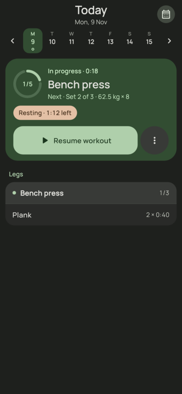
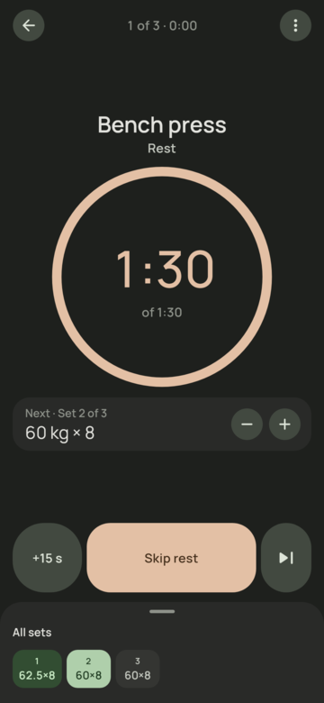
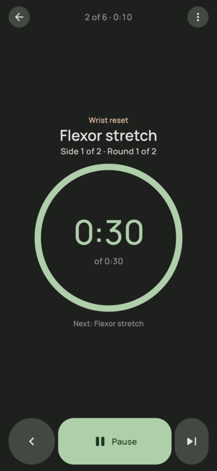
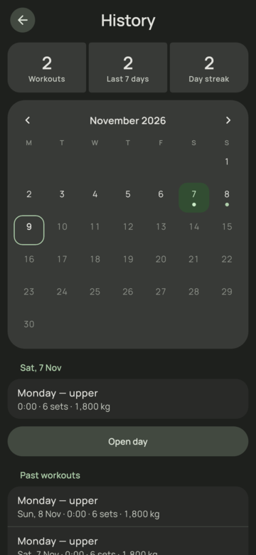

# Fit

> Another vibe-coded app (see [hush](https://github.com/moxcz/hush)). Design based on [Tomato](https://github.com/nsh07/Tomato)

A small workout app for Android. No accounts, and nothing goes to the internet.

| Today                                                      | Workout                                                    | Recovery session                                    | History                                               |
| ---------------------------------------------------------- | ---------------------------------------------------------- | --------------------------------------------------- | ----------------------------------------------------- |
|  |  |  |  |

## What it does

- **Routines and exercises.** Build routines from a library of exercises, with sets, reps or time,
  rest, warm-up sets and progression.
- **A guided workout.** One exercise at a time on a dial of its sets, with rest timers and timed
  sets that keep running with the screen off.
- **Programs.** A routine or a rest for each weekday, with deload weeks that cut the loads.
- **History and progress.** A calendar, a summary with records after each workout, a chart for each
  exercise, and a body weight log.
- **Recovery sessions.** Short follow-along sessions by body area, one step at a time, with an
  optional daily reminder.
- **Lessons.** Notes for teaching yourself an exercise, with a practice drill.
- **Your own content.** Routines, sessions and lessons are plain Markdown files you can write and
  import ([the format](docs/content-format.md)).
- **Backup.** Export everything as one file and restore it.

How to use each screen is in the [user guide](shared/src/commonMain/composeResources/files/user-guide.md),
which the app also shows under More → Help.

## Installing

Download the APK for the newest version from the
[releases page](https://github.com/MoXcz/fit/releases/latest) and open it on the phone. Pick
`arm64-v8a` (almost every current phone) or `universal`, which works on every phone and is twice the
size. Fit needs Android 8.0 or later.

To build it from source instead, see [docs/building.md](docs/building.md).

## Credits and licences

Fit is GPL-3.0-or-later ([LICENSE](LICENSE)). It shares its architecture and look with
[Hush](https://github.com/MoXcz/hush), which builds on [Tomato](https://github.com/nsh07/Tomato) by
Nishant Mishra. Developer documentation is in [docs/](docs/README.md).
